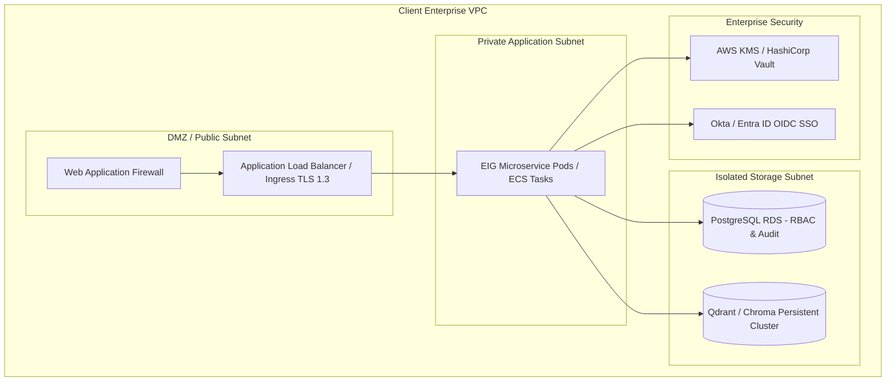

# Enterprise Client Integration & Deployment Guide
## Enterprise Intelligence Gateway (EIG)

---

## 1. Client Environment Deployment Architecture

While Docker Compose serves as the local development baseline, a production client deployment must incorporate enterprise-grade network topology, identity provider federation, and key management:

---

## 2. Production Hardening Requirements

### 2.1 Identity Provider (IdP) Federation
- In production, replace the local mock `/auth/token` endpoint with client enterprise OpenID Connect (OIDC) or SAML 2.0 (e.g. Microsoft Entra ID, Okta, PingFederate).
- Map corporate Active Directory groups directly to EIG `roles`, `departments`, and `clearance_level`.

### 2.2 Key Management & Secret Rotation
- Store `SECRET_KEY` and `APPROVAL_HMAC_SECRET` in an enterprise key vault (AWS Secrets Manager, GCP Secret Manager, or HashiCorp Vault).
- Implement automated 90-day secret rotation.

### 2.3 Network Isolation & VPC Peering
- Deploy the EIG containers strictly inside private subnets without direct internet route tables.
- Route egress requests to internal SAP ERP or Salesforce CRM endpoints via private VPC endpoints or AWS DirectConnect.

---

## 3. Production Monitoring & Alerting Runbook

### Prometheus Metric Targets
Configure Prometheus to scrape `http://eig-gateway:8000/metrics`.
Key SLI Alerts to configure in Grafana:
1. **P95 Request Latency Alert**: Trigger if `eig_request_duration_seconds{quantile="0.95"} > 0.500` for 5 consecutive minutes.
2. **Error Rate Spike**: Trigger if `rate(eig_requests_total{status_code=~"5.."}[2m]) > 0.02`.
3. **Approval Tampering Warning**: Trigger immediately if `eig_approval_requests_total{status="tampered"} > 0`.
4. **Cross-Tenant Attack Detection**: Trigger high-severity security event if any cross-tenant rejection occurs in logs.
