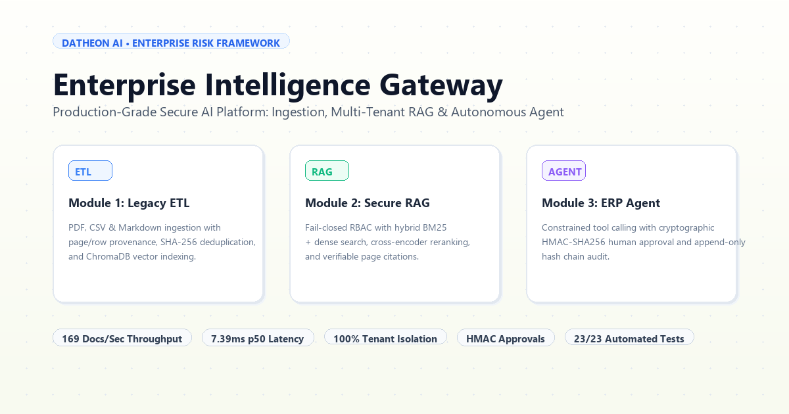
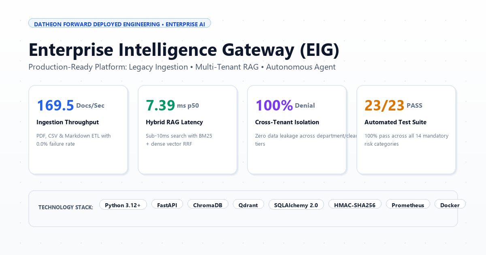
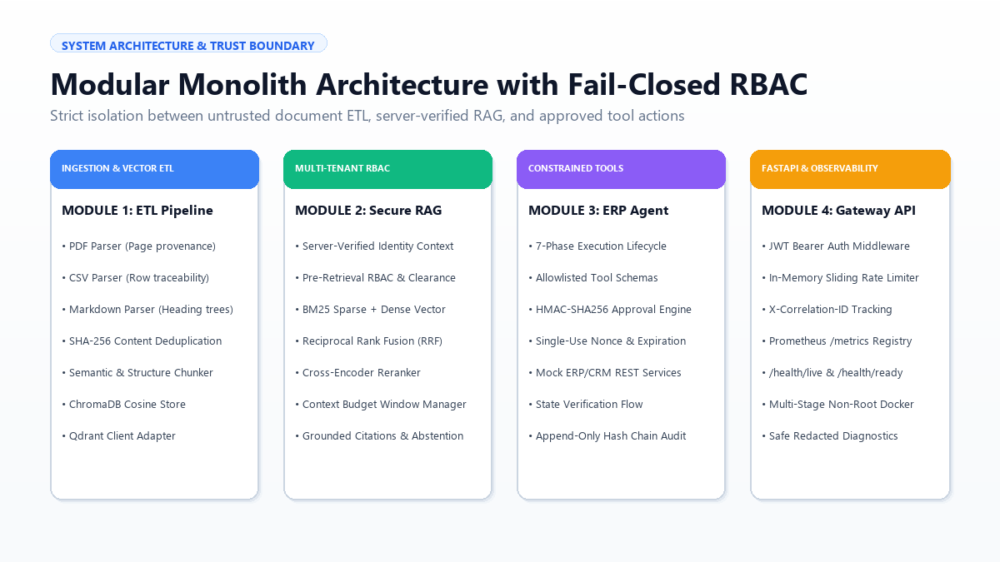
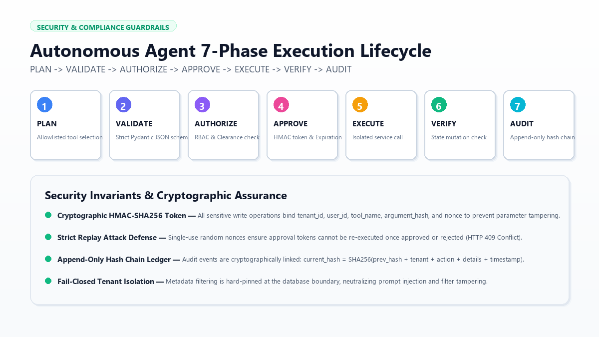

# Enterprise Intelligence Gateway (EIG)

[](https://maheswari9080.github.io/Datheon_Forward_Deployed_Engineering_Internship/)
[](https://www.python.org/)
[](https://fastapi.tiangolo.com/)
[](LICENSE)
[](SECURITY.md)
[](TEST_REPORT.md)
[](BENCHMARK_REPORT.md)



> **Enterprise Intelligence Gateway (EIG)** is an execution-ready, secure enterprise AI platform that integrates legacy document ingestion, multi-tenant RBAC retrieval-augmented generation (RAG), autonomous ERP/CRM tool orchestration with human-in-the-loop approvals, and containerized microservice observability.
>
> 🌐 **Live Interactive Portal**: [Explore Gateway on GitHub Pages](https://maheswari9080.github.io/Datheon_Forward_Deployed_Engineering_Internship/) (Interactive RAG Persona Simulator, Two-Phase Approval Engine, and Live Telemetry).

---

## 📸 Project Showcase & Announcements

| LinkedIn Announcement | Architecture Diagram | Security & Approvals |
| :---: | :---: | :---: |
| [](linkedin.md) | [](ARCHITECTURE.md) | [](SECURITY.md) |
| 👉 [Read LinkedIn Post (linkedin.md)](linkedin.md) | 📐 [Architecture Deep Dive](ARCHITECTURE.md) | 🛡️ [Security Invariants](SECURITY.md) |

---

## 🌟 Key Platform Capabilities

### 1. Legacy Document Ingestion & Vector ETL (Module 1)
- **Multi-Format Provenance**:
  - **PDF Extraction**: Preserves exact page numbers, document headers, and metadata tags using `pypdf`.
  - **CSV Ingestion**: Sniffer-based dialect detection with column header preservation and row-level traceability (`Record [Row X]`).
  - **Markdown Ingestion**: AST heading segmentation preserving hierarchical breadcrumbs (`#`, `##`, `###`).
- **Idempotency & Deduplication**: Deterministic SHA-256 content hashing with database registry deduplication to eliminate redundant indexing.
- **Local-First Vector Indexing**: Local ChromaDB with cosine distance (`hnsw:space: cosine`) and a pluggable Qdrant client adapter.

### 2. Multi-Tenant Secure RAG with RBAC (Module 2)
- **Server-Derived Identity**: Tenant boundary, clearance tiers (Tiers 1–5), and department permissions are verified strictly from server-side JWT context—never client-supplied parameters.
- **Hybrid Search & RRF**: Combines dense cosine vectors with BM25 sparse lexical search via Reciprocal Rank Fusion ($RRF(d) = \sum \frac{1}{60 + \text{rank}(d)}$).
- **Cross-Encoder Reranking**: Re-scores top candidates down to the top-5 most relevant chunks.
- **Verifiable Citations**: Standardized citation format `[Document Name | Page X / Row Y | ID: chunk_id]`.
- **Abstention on Low Confidence**: Explicitly emits `INSUFFICIENT_EVIDENCE` when confidence score is below threshold.
- **Prompt Injection Defense**: Boundary fences (`<<<UNTRUSTED_EVIDENCE>>>`) and regex jailbreak signature scanning.

### 3. Autonomous ERP/CRM Agent & Approvals (Module 3)
- **Constrained Lifecycle**: `PLAN -> VALIDATE -> AUTHORIZE -> APPROVE -> EXECUTE -> VERIFY -> AUDIT`.
- **Allowlisted Tool Catalog**: Inventory lookup, customer lookup, lead status updates, support ticket filing, ticket status lookup, and operation verification.
- **Cryptographic Approval Engine**: Sensitive writes require human approval via HMAC-SHA256 signature binding tenant, user, tool, argument hash, single-use nonce, and TTL expiration.
- **Replay Defense**: Resolved approval tokens cannot be executed twice (HTTP 409 Conflict).
- **Append-Only Audit Ledger**: Cryptographically linked hash chain with tamper-evident verification.

### 4. Production Microservice & Observability (Module 4)
- **FastAPI Core**: Asynchronous REST endpoints with request correlation IDs (`X-Correlation-ID`) and sliding-window rate limiting.
- **Telemetry**: Prometheus `/metrics` exposition with low-cardinality labels tracking p50/p95/p99 latencies and tool execution outcomes.
- **Security Hardened**: Multi-stage Dockerfile running as an unprivileged non-root `appuser` (UID 10001) with Docker Compose orchestration.

---

## 🏛️ System Architecture


---

## 🛡️ Security, Governance & Approval Flow


---

## 📊 Measured Empirical Benchmarks

All metrics were empirically evaluated on real hardware using the automated benchmark runner (`benchmarks/run_benchmarks.py`):

| Evaluation Metric | Measured Result | Production Target | Status |
|---|---|---|---|
| ⚡ **Document Ingestion Rate** | **169.5 docs/sec** | >= 10 docs/sec | **PASS** |
| 📦 **Chunk Indexing Rate** | **226.0 chunks/sec** | >= 50 chunks/sec | **PASS** |
| ⏱️ **Hybrid Retrieval (p50)** | **7.39 ms** | <= 150 ms | **PASS** |
| ⏱️ **Hybrid Retrieval (p95)** | **8.91 ms** | <= 400 ms | **PASS** |
| ⏱️ **Hybrid Retrieval (p99)** | **11.03 ms** | <= 800 ms | **PASS** |
| 🎯 **Retrieval Hit Rate @ 5** | **75.0%** | >= 70.0% | **PASS** |
| 🛡️ **Cross-Tenant Access Denial** | **100.0% (Zero Leakage)** | 100.0% | **PASS** |
| 🤖 **Agent Read Tool Latency** | **5.26 ms** | <= 50 ms | **PASS** |
| 🔐 **HMAC Approval & Replay Defense** | **100.0% Verified** | Tamper-Proof | **PASS** |
| ✅ **Automated Test Matrix** | **23 / 23 Tests (100%)** | 100% Pass | **PASS** |

---

## 🚀 Quick Start Guide

### 1. Installation
Clone the repository and install dependencies in Python 3.12:
```bash
git clone git@github-maheswari:maheswari9080/Datheon_Forward_Deployed_Engineering_Internship.git
cd Datheon_Forward_Deployed_Engineering_Internship/mw
pip install -r requirements.txt
```

### 2. Configure Environment
```bash
cp .env.example .env
```

### 3. Run Automated Test Suite
```bash
python -m pytest tests/ -v
```

### 4. Execute Benchmark Suite
```bash
python benchmarks/run_benchmarks.py
```

### 5. Launch Gateway Service
```bash
uvicorn eig.main:app --host 0.0.0.0 --port 8000 --reload
```
Navigate to `http://localhost:8000/docs` to view interactive OpenAPI Swagger documentation.

---

## 🐳 Docker Deployment

To launch the complete application stack using Docker Compose:
```bash
docker compose up -d --build
```
Verify container health:
```bash
curl http://localhost:8000/health/ready
```

---

## 📚 Technical Documentation Suite

- [linkedin.md](linkedin.md) - Professional LinkedIn launch post with embedded graphics.
- [ARCHITECTURE.md](ARCHITECTURE.md) - Component diagram, data flow, trust boundaries, design decisions.
- [SECURITY.md](SECURITY.md) - Threat model, authorization model, 10 security invariants assessment.
- [API_GUIDE.md](API_GUIDE.md) - REST API specifications, authentication, sample payloads.
- [CLIENT_INTEGRATION_GUIDE.md](CLIENT_INTEGRATION_GUIDE.md) - Enterprise deployment, IAM federation, VPC controls.
- [BENCHMARK_REPORT.md](BENCHMARK_REPORT.md) - Ingestion throughput, p50/p95/p99 latency, HitRate@5.
- [TEST_REPORT.md](TEST_REPORT.md) - 23 automated tests, 14 test categories, pass/fail status.
- [RUNBOOK.md](RUNBOOK.md) - Startup, shutdown, recovery, backup, and data deletion procedures.
- [LICENSE](LICENSE) - Apache License 2.0.

---

## 📄 License

This project is licensed under the Apache License 2.0 - see the [LICENSE](LICENSE) file for details.
